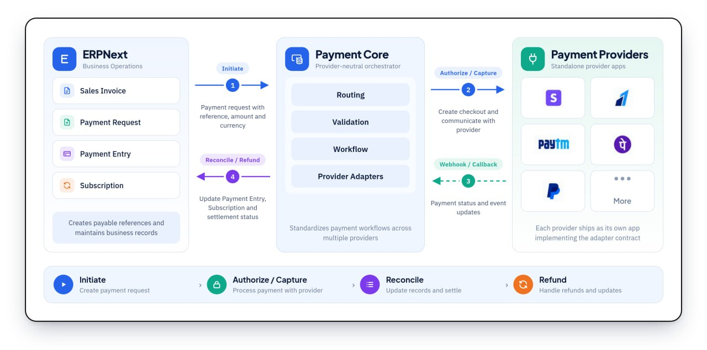

<div align="center">
<a href="https://integrations.frappe.cloud/integrations/payment-integration/payment-core/payment-overview">

</a>
<h2>Payment Core</h2>
<p>Provider-neutral payment infrastructure for Frappe and ERPNext</p>

[](https://github.com/aerele/payment-core/actions/workflows/ci.yml)
[](https://github.com/aerele/payment-core/actions/workflows/linter.yml)
[](license.txt)
</div>

<br>
<div align="center">

</div>
<br>
<div align="center">
<a href="https://integrations.frappe.cloud/integrations/payment-integration/payment-core/payment-overview">Documentation</a>
·
<a href="https://github.com/aerele/payment-core/issues">Report an Issue</a>
·
<a href="https://github.com/aerele/payment-core/pulls">Contribute</a>
</div>

## Payment Core

Payment Core provides the shared contracts and provider-neutral workflows used by payment gateway apps on Frappe. It integrates gateways with ERPNext payment records and Web Forms while keeping credentials, provider APIs, checkout interfaces, webhooks, and branding inside separate provider apps.

Payment Core is not a payment gateway and cannot accept payments on its own. Install a compatible provider app such as [Stripe Payment](https://github.com/aerele/stripe-payment) or [Razorpay Payment](https://github.com/aerele/razorpay-payment) to process transactions.

## Key Features

- **Gateway registry**: Register Payment Gateways and resolve their settings controllers consistently.
- **Controller contract**: Define a common interface and mixin for standalone gateway apps.
- **Secure references**: Validate payment references and resolve payable amounts and currencies from server-side records.
- **ERPNext settlement**: Authorize reference documents and settle Payment Requests without duplicating Payment Entries.
- **Web Form payments**: Add payment configuration to Web Forms and redirect successful submissions to the selected gateway.
- **Subscription dispatch**: Route subscription creation to handlers registered by provider apps.
- **Shared payment pages**: Provide common success, failure, and cancellation routes for checkout flows.
- **Payment Core workspace**: Give desk users one place to reach the payment records available in
  the active site mode and Payment Analytics.
- **Payment Analytics**: Show payment volume, successful payments, customers, average payment,
  volume over time, and gateway setup warnings, using the payment flow available on the site.
- **Gateway Settings hub**: Let System Managers discover and open settings for installed gateway
  apps from a shared page.

## Desk workspace and payment operations

After installing Payment Core, open the **Payment Core** workspace from the desk. Payment Gateway,
Payment Webhook Log, Payment Core Settings, and Payment Analytics apply to both site modes. On a
shared-ledger site, the workspace also provides Payment Transaction, Payment Receipt, and Payment
Field Mapping access. Those ledger records and the field-mapping builder are unavailable in
gateway-only mode.

The full **Payment Analytics** report lives in its own **Payment Analytics** workspace
(sidebar entry, `/desk/payment-analytics`) available to users with the Payment Manager, Payment
User, or System Manager role. Choose a period, currency, or reference type to review gross captured
volume, successful payment count, distinct customers, average payment, volume over time, payment
methods, and recent, open, or failed payments. The workspace home instead shows a compact Payment
Summary (last 30 days) with a link to the full report; it also reports gateway configuration
warnings when the settings controller exposes them. Its data source adapts to the
site: it reads the shared payment ledger when available and uses the installed gateway or ERPNext
flow otherwise. KPI cards and the volume chart follow the selected currency and period. Recent and
open payment lists have their own window controls. The Failed payments list is a latest-record list
without a period or currency control.

System Managers can open the **Gateway Settings** hub directly at `/desk/gateway-settings`. The
workspace does not currently link to this page. The hub lists gateways registered on the site,
displays their reported health and setup warnings, and links to each gateway app's settings. Use
**Add Gateway** to select an installed gateway settings DocType, or **Manual Payment Gateway** when
configuring a gateway without a provider app. Provider credentials and provider-specific setup
remain managed by the provider app; see its README for those steps.

### Under the Hood

- [**Frappe Framework**](https://github.com/frappe/frappe): The full-stack framework on which Payment Core and provider apps run.
- [**ERPNext**](https://github.com/frappe/erpnext): Provides Payment Request, Payment Entry, and accounting workflows.
- [**Provider Apps**](https://github.com/aerele): Implement provider-specific checkout, credentials, APIs, webhooks, and reconciliation.

## Installation

Payment Core targets Frappe and ERPNext version 16 through `develop`. The current `develop` branch requires Python 3.14 or newer.

Set up a Frappe bench by following the [Frappe installation guide](https://docs.frappe.io/framework/user/en/installation).

### With ERPNext (gateway-only mode)

On an ERPNext site, Payment Core acts as the gateway layer for ERPNext's Payment Request flow. The shared ledger is not installed — ERPNext's Payment Entry remains the money voucher.

```sh
bench get-app erpnext --branch develop
bench get-app https://github.com/aerele/payment-core --branch develop
bench --site <site-name> install-app erpnext
bench --site <site-name> install-app payment_core
```

### Without ERPNext (shared ledger mode)

On a plain Frappe site, Payment Core installs the shared Payment Ledger: Payment Transaction, Payment Receipt, and Payment Field Mapping doctypes. Custom apps use these as their payment records.

```sh
bench get-app https://github.com/aerele/payment-core --branch develop
bench --site <site-name> install-app payment_core
```

### Site modes

| Site has | Mode | What you get |
|---|---|---|
| ERPNext | Gateway-only | Payment Requests for supported ERPNext reference types; Payment Core resolves gateways and settles into Payment Entries |
| Plain Frappe | Shared ledger | Payment Transaction, Payment Receipt, Payment Field Mapping |
| App with `uses_own_payment_flow = True` | Gateway-only | Your app's payment doctypes; Payment Core provides the gateway registry and checkout |

Set `force_payment_ledger: 1` in `site_config.json` to keep the shared ledger on an ERPNext site only
after confirming which app owns payment state, accounting, and settlement. This override can create
overlapping payment records if ownership is unclear.

### Install a gateway app

Payment Core cannot process payments on its own. Install at least one gateway app:

```sh
# Stripe
bench get-app https://github.com/aerele/stripe-payment --branch develop
bench --site <site-name> install-app stripe_payment
```

Then visit `/desk/gateway-settings`, click **Add Gateway**, select the gateway's settings DocType, and
configure its credentials. Refer to each gateway app's README for provider-specific setup, webhooks,
and test keys.

## Quick start

### ERPNext sites (gateway-only mode)

1. **Install** Payment Core and a gateway app (see above).
2. **Configure the gateway** at `/desk/gateway-settings`.
3. **Create a supported ERPNext reference** from the custom app's record, normally a Sales Order or
   Sales Invoice, then raise the Payment Request against that ERPNext document. ERPNext does not
   allow Payment Request to target an arbitrary custom DocType.
4. **Test through Payment Request** and verify the resulting Payment Entry and outstanding amount.

If the custom DocType must remain the payable reference, the custom app must own its payment
lifecycle and declare `uses_own_payment_flow = True`; follow the gateway-only integration branch in
`AGENTS.md`.

### Plain Frappe sites (shared-ledger mode)

1. **Install** Payment Core and a gateway app (see above).
2. **Configure the gateway** at `/desk/gateway-settings`.
3. **Map a DocType** at `/desk/payment-field-mapping-builder`, selecting the payable custom DocType
   and mapping its amount and other available payment fields.
4. **Test a payment** through a compatible Web Form or call
   `payment_core.utils.create_payment_transaction` from the custom app.

## Troubleshooting

- **"Shared ledger not installed on this site"** — The site is in shared-ledger mode, but the ledger
  tables do not exist yet. Run `bench --site <site-name> migrate`. If an app owns its payment flow,
  check that it declares `uses_own_payment_flow = True` and registers a
  `payment_analytics_adapter`.
- **"Payment Field Mapping is not installed on this site"** — The site is in gateway-only mode, so
  the field-mapping builder and shared-ledger DocTypes are unavailable.
- **Webhook not arriving** — Check the Gateway Settings hub page for health warnings. Verify the webhook endpoint URL and signing secret in your gateway's settings.
- **Payment stuck in Initiated** — The daily reconcile job re-checks open transactions with the provider. You can also trigger it manually: `bench --site <site-name> execute payment_core.tasks.reconcile_stale_transactions`.
- **Analytics show no data** — Verify the period and currency filters for KPIs and the volume chart.
  On gateway-only sites, analytics read from the site's own flow (e.g., ERPNext Payment Requests).

## Building a Gateway App

A standalone provider app should:

1. Declare `required_apps = ["payment_core"]` in its hooks.
2. Implement a settings controller using `GatewayControllerMixin` and Frappe's `Document` class.
3. Provide `get_payment_url` and `validate_transaction_currency` methods.
4. Register its Payment Gateway with `payment_core.utils.create_payment_gateway`.
5. Use shared reference, amount, redirect, authorization, and settlement helpers where applicable.
6. Keep provider credentials, SDK clients, checkout pages, webhooks, and reconciliation inside the provider app.

See the [Payment Core documentation](https://integrations.frappe.cloud/integrations/payment-integration/payment-core/payment-overview) for the gateway architecture and integration workflow.

## Development

This app uses `pre-commit` for formatting and linting:

```sh
cd apps/payment_core
pre-commit install
```

Run the test suite with:

```sh
bench --site <site-name> run-tests --app payment_core
```

## Contributing

Contributions are welcome. Shared changes should remain provider-neutral and reusable across gateway apps. Before opening a pull request, please create or reference an [issue](https://github.com/aerele/payment-core/issues) and ensure the test suite and pre-commit checks pass.

## License

This project is licensed under the [MIT License](license.txt).

<br>
<br>
<div align="center">
  <a href="https://aerele.in">
    <picture>
      <source media="(prefers-color-scheme: dark)" srcset="./payment_core/public/images/aerele-dark.png">
      
    </picture>
  </a>
</div>
